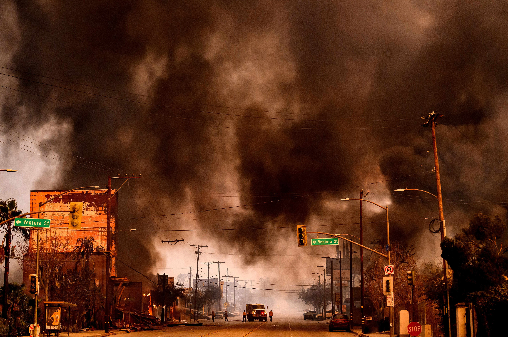

# Visualizing fire scars from Eaton and Palisades Fire 2025


Palisades Fire seen in the business district of Altadena on January 8, 2025.

### About
We are interested in using Landsat8 bands data to create a false color imagery in order to see fire scars for the Eaton and Palisades fires in Los Angeles in 2025. These were the two most devasting fires for the season. We create a false color map to show the scars. All the analysis is done in notebooke `hwk4-task2-false-color-loo.ipynb`.

### Highlights:
- Exploration of data with `geopandas` and `xarray`
- Cleaning geospatial data
- Subsetting `rioxarray` data
- Plotting geospatial data with layers

### Repo Structure
```
.
├── LICENSE
├── README.md
├── .gitignore
│   └── data
│      ├── fire25_1.gdb
│      └── landsat8-2025-02-23-palisades-eaton.nc
└── hwk4-task2-false-color-loo.ipynb # Jupyter notebook with visualization analysis
```

### Data
The data is not housed in this repository due to the file size.
* `fire25_1.gdb`: Downloaded from CAL FIRE
* `landsat8-2025-02-23-palisades-eaton.nc`: Downloaded from EDS220 class folder

### References
U.S. Geological Survey. (2025). *Landsat 8*. U.S. Geological Survey. [Accessed Nov 18, 2026]\
Wallin, Kimberly. (2026). *Fire Perimeters*. California Department of Forestry and Fire Protection. [Accessed Nov 18, 2026]

### Acknowledgements
Author: Kelly Loo\
Intructor: Carmen Galaz García\
Teaching Assistant: Fatiq Nadeem